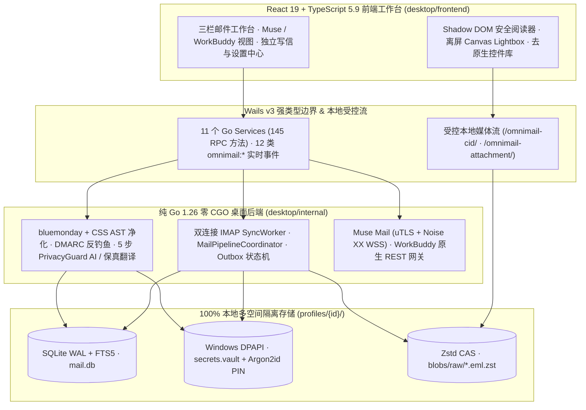

<div align="center">

<picture>
  <source media="(prefers-color-scheme: dark)" srcset="desktop/frontend/src/assets/brand/logo-dark.svg" />
  <source media="(prefers-color-scheme: light)" srcset="desktop/frontend/src/assets/brand/logo.svg" />
  
</picture>

# OmniMail

**本地优先 · 零云端上传 · 透明隐私边界的多源统一桌面邮件工作台**

*A Local-First, Zero-Cloud-Account Unified Desktop Mail & AI Agent Mailbox Workspace*

[](https://github.com/mibgb65-cloud/OmniMail-APP/actions/workflows/ci.yml)
[](https://github.com/mibgb65-cloud/OmniMail-APP/releases)
[](https://github.com/mibgb65-cloud/OmniMail-APP/releases)
[](docs/architecture/TECH_STACK.md)
[](docs/development/BUILD.md)
[](LICENSE)

[**立即下载**](#quick-start) · [**为什么做 OmniMail**](#why-omnimail) · [**18+ 邮箱矩阵**](#providers) · [**核心特性**](#features) · [**隐私与安全边界**](#privacy) · [**系统架构**](#architecture) · [**源码构建**](#build) · [**分支与贡献**](#contributing) · [**特别致谢**](#acknowledgments)

</div>

---

<a id="why-omnimail"></a>

## 为什么做 OmniMail？

在桌面端管理多个个人邮箱、社区邮箱、企业邮箱与新兴的 AI Agent 邮箱时，开发者与重度用户往往面临三重割裂：

1. **沉重或越界的客户端**：动辄数百 MB 的打包体积与高常驻内存，或强制要求注册厂商云账号、将 IMAP 授权码与邮件正文同步至第三方服务器；
2. **本土与极客生态水土不服**：连接 **Linux.do 社区邮箱**、网易 `RFC2971 ID` 握手、QQ 邮箱长连接断流与裸 `GB18030` 头编码、Gmail `All Mail` 重复会话，或是 **Meta Muse (`@muse.ai`)**、**腾讯 WorkBuddy** 等智能体专属邮箱时，传统客户端要么报错繁琐，要么完全无法接入；
3. **黑盒化的 AI 与翻译**：许多标榜 AI 的邮件工具无差别上传验证码、银行账单与邮件附件，缺乏可审计的脱敏与拦截边界。

**OmniMail** 基于 **Go 1.26（纯 Go 零 CGO）+ Wails v3 + React 19** 构建，安装包仅 **~7.4 MB**。它不设任何云端账号体系，所有凭据、邮件原文与全文索引 **100% 存储在你的本地磁盘**；原生内置 **Linux.do 社区邮箱**、**2 款 AI Agent 专属邮箱工作台** 与 **15 家国内外个人/企业邮局预设**，同时提供**免配置开箱即用的保真邮件翻译**与受 **5 步 `PrivacyGuard`** 严格约束的 BYOK 多模型 AI 助手。

> [!TIP]
> **致 Linux.do 社区佬友**：OmniMail 原生内置了 **Linux.do 邮箱**专属接入预设与四阶段（`DNS → TLS → IMAP → SMTP`）实时握手诊断，同时支持一站式挂载 **Meta Muse (`@muse.ai`)** 与 **腾讯 WorkBuddy** 智能体邮箱、免 Key 双语对照翻译及自定义 OpenAI 兼容网关 / 本地 Ollama。

---

<a id="providers"></a>

## 开箱即用的 18+ 全景邮箱矩阵

统一 `980×760` 零跳动双栏选型引导，支持按 **AI Agent / 个人与社区 / 企业邮箱** 分类筛选、搜索与 **DNS MX 自动识别**：

### 1. 社区极客与 AI Agent 专属工作台

| 邮箱服务 | 接入方式 | 核心工程适配与安全边界 |
| :--- | :--- | :--- |
|  **Linux.do 社区邮箱** | 专属预设向导 | 内置服务器参数预设与客户端令牌指引，支持 4 阶段握手实时测连与双连接 `IDLE` 秒级推送 |
|  **Meta Muse Mail (`@muse.ai`)** | 独立隔离网页登录 | 零 Python/`muse-cli` 依赖；独占临时目录暗色 WebView2 官方登录（`1.5s` 自动感知会话关窗），Go 原生 `uTLS`（兼容系统 HTTP `CONNECT` / `SOCKS5` 代理）+ `Noise XX` + `Protobuf WSS` 只读接入，**纯内存驻留，切空间/锁屏即刻销毁** |
|  **腾讯 WorkBuddy Agent 邮箱** | 浏览器轮询授权 | 零 Node/CLI 依赖；Go 原生 REST 客户端管理单飞 `401` 自动续期、每日配额感知、`bluemonday` 净化阅读、25 MB 附件流式另存与两步令牌确认删除 |

### 2. 国际与国内主流个人邮箱（8 家）

| 服务商 | 认证与针对性深度适配 | 服务商 | 认证与针对性深度适配 |
| :--- | :--- | :--- | :--- |
|  **Gmail** | PKCE OAuth2 + 16 位应用专用密码回退、`All Mail` 会话智能去重 |  **Outlook / Hotmail** | PKCE OAuth2 官方现代认证、Special-Use 文件夹自动映射 |
|  **QQ 邮箱 / Foxmail** | 授权码接入、`IDLE` 瞬断容错自愈与历史回溯、裸 `GB18030` 头解码修复 |  **网易邮箱 (`163` / `126`)** | 原生实现 `RFC2971` IMAP `ID` 握手协议，彻底告别 `Unsafe Login` 报错 |
|  **Apple iCloud Mail** | 应用专用密码预设与 TLS 握手校验 |  **Yahoo Mail** | 官方 IMAP/SMTP 预设与连接诊断 |
|  **Yandex Mail** | 官方预设与多字符集容错解码 |  **Naver Mail (`@naver.com`)** | 韩国 Naver 邮箱预设与 `EUC-KR` / CJK 编码完整支持 |

### 3. 企业邮箱与自建邮局（6 家企业预设 + 通用协议）

| 企业邮服务商 | 企业邮服务商 | 企业邮服务商 |
| :--- | :--- | :--- |
|  **腾讯企业邮** (`exmail.qq.com`) |  **阿里企业邮** (`qiye.aliyun.com`) |  **网易灵犀企业邮** (`qiye.163.com`) |
|  **飞书邮箱** (Feishu / Lark Mail) |  **263 企业邮** |  **Zoho Workplace 企业邮** |

- **通用 IMAP / SMTP 接入**：完整支持 Mailcow、Poste.io、Stalwart、青羽/自建 Postfix+Dovecot 等任意标准邮局，输入域名即可通过 **DNS MX 记录自动推断服务器参数**。

---

<a id="features"></a>

## 核心特性一览

### 1. 100% 本地优先与纵深安全基线
- **多本地空间物理隔离（Local Profiles）**：无需注册登录，支持创建多个完全独立的本地工作空间（如「个人日常」「开源社区」「工作企业」）。每个空间拥有物理隔离的 SQLite 库、加密凭据盒与附件存储，支持独立设置 **Argon2id 密码学派生 PIN 锁**与系统托盘一键切空间。
- **Windows DPAPI 硬件级凭据保险箱**：OAuth2 刷新令牌、IMAP 授权码与 AI API Key 统一经 Windows 系统级 `DPAPI` 加密写入本地 `secrets.vault`，绝不明文落盘。
- **白名单 HTML/CSS 沙箱与可逆追踪拦截**：采用 `bluemonday` + 自研 CSS AST 白名单净化器（自动剥离 MSO 条件注释、重写全局 `prefers-color-scheme` 防止邮件样式污染宿主）配合 **Shadow DOM 隔离渲染**；默认拦截一切外链 `` 与 CSS `background: url(...)` 追踪像素，支持单封/空间级**无损可逆还原**（存量邮件亦可从本地 `.eml.zst` 按需自动恢复）。
- **DMARC 对齐反钓鱼与外链防误触**：本地解析 `Authentication-Results` 校验 `SPF / DKIM / DMARC` 对齐状态，驱动三段式分色安全警示横幅；点击正文外部链接弹出目标域名二次确认框，支持受信域名白名单。

### 2. 免 Key 保真翻译 & 5 步 `PrivacyGuard` AI 助手
- **开箱即用保真邮件翻译**：**默认无需配置任何 AI 账号或 API Key**，手动点击即可逐批流式翻译外文邮件，支持 **原文 / 译文 / 双语对照** 一键切换；只替换已净化 DOM 的文本节点，100% 保留原邮件表格、按钮、代码块与超链接排版，同样支持随时切换至自有 BYOK 模型。
- **多引擎 BYOK 透明接入**：原生支持 **OpenAI、Anthropic Claude、Google Gemini、DeepSeek、本地 Ollama** 及任意 **HTTPS OpenAI 兼容中转/自建网关**（密钥按空间、厂商与规范化端点严格隔离）。
- **全场景邮件 AI 能力**：结构化阅读摘要、待办事项与截止时间提取、多语气回复草稿生成、基于当前邮件的上下文多轮问答（最近 10 轮本地缓存），以及带四层 60fps 流光动效的 **写信内联 AI（润色 / 扩写 / 精简 / 翻译，支持替换或追加采纳）**。
- **5 步 `PrivacyGuard` 强约束**：
  1. **敏感邮件硬拦截**：自动识别验证码、登录安全码、银行账单与财务敏感邮件并拒绝送入模型；
  2. **最小上下文提取**：仅提取当前邮件可见纯文本与可选主题，**永不读取邮件头、永不上传任何附件或附件名**；
  3. **云端 PII 强制脱敏**：发往云端模型前自动对手机号、身份证号、银行卡号、密钥串等敏感字段执行正则脱敏；
  4. **显式授权门禁**：默认关闭自动摘要，拟稿与追问永不后台静默触发；
  5. **人工终审发送**：AI 生成的回复仅填入编辑器草稿，**绝不代替用户自动发送邮件**。

### 3. 高性能双连接引擎与防误发发件队列
- **双连接 IMAP 同步（`workConn + idleConn`）**：读写分离并发架构，`idleConn` 维持 24 分钟周期 `IDLE` 实时推送，遇到瞬时网络抖动具备 2 次静默短退避自愈能力，顶栏微胶囊实时呈现非打扰式同步进度。
- **SQLite WAL + FTS5 毫秒级检索 + Zstd CAS 归档**：使用纯 Go `modernc.org/sqlite` 开启 `WAL` 并发模式与 `FTS5 trigram` 全文索引（针对 1~2 字中文短词提供精准降级匹配）；原始 `.eml` 经 `Zstandard` 高压缩比内容寻址去重存储，同文件跨邮件零冗余。
- **发件身份强锁定与持久化 `outbox_jobs` 状态机**：回复/转发默认锁定原收件邮箱身份（前后端双重 `ERR_IDENTITY_LOCKED` 校验防串号）；支持 **5s / 10s / 20s 零网络真撤回发送（Undo Send）**、**跨应用重启定时发送**、断网指数退避重发、剪贴板/拖拽 `cid:` 内嵌图组装（`multipart/related`），且严格保证 `BCC` 密送地址仅走 SMTP 信封、绝不写入 MIME 头。

### 4. 全套效率工具与精雕桌面体验
- **自动化规则引擎（支持 30 天干跑预览）**：创建多条件收件规则前，可一键在本地最近 30 天真实邮件上执行 **Dry-Run 预览命中明细**，确认无误再启用；内置 `RFC3834` 防死循环休假自动回复与子域名黑名单。
- **智能通讯录与 `.ics` 日程协同**：自动从往来邮件沉淀联系人，智能识别同名与 `+alias` 重复候选并支持单事务无损合并、vCard 导入导出；邮件内 `.ics` 邀请自动检测本地日程冲突，支持一键发送 `Accept / Tentative / Decline` 标准 `METHOD:REPLY` 回执。
- **轻量化标签与沉浸式交互细节**：支持 `L` 快捷键、阅读器顶栏与右键级联菜单三态秒贴标签及原地新建/改色；内置**离屏 Canvas 像素级明暗与透明度采样**的图片 Lightbox（自动为深色透明 Logo 匹配浅雾衬底，告别黑底黑字看不清）；支持 **中英双语（`zh-CN` / `en-US`）实时切换**、GPU 可中断亮暗扩散主题过渡、暗黑阅读「智能深色适配 / 原始白底」一键切换、`mailto:` / `.eml` / `.ics` 系统协议唤起，以及 **Stable / Beta 双通道后台 SHA-256 强校验静默覆盖升级**。

---

<a id="privacy"></a>

## 隐私与安全边界一览

OmniMail 坚持「默认最小权限、所有网络出站可解释」的工程原则：

| 数据资产 | 存储位置与保护机制 | 网络出站策略 |
| :--- | :--- | :--- |
| **账号密码 / OAuth Token / API Key** | 本地空间 `secrets.vault`（Windows `DPAPI` 加密） | 仅直连对应邮局 IMAP/SMTP/OAuth 服务器或用户填写的 AI 端点 |
| **邮件原文（`.eml`）与附件** | 本地空间 `blobs/`（`Zstd` 压缩 CAS 内容寻址） | **永不上传第三方云端或 AI 模型**；附件按需下载并支持 LRU 缓存清理 |
| **邮件索引、标签、规则与通讯录** | 本地空间 `mail.db`（SQLite WAL + Argon2id PIN 门禁） | 100% 本地离线运算，零遥测、零行为埋点上报 |
| **Meta Muse (`@muse.ai`) 会话** | 仅驻留当前活跃空间进程内存 + 临时隔离 WebView2 目录 | 仅直连官方认证域与加密 WSS；切空间/锁屏/退出立即清空内存与临时目录 |
| **邮件翻译与 BYOK AI 请求** | 译文按会话隔离，摘要/问答按空间存于 `ai_insights` | 敏感邮件硬拦截；仅在用户触发（或显式开启自动摘要）时经脱敏发送可见正文 |
| **故障排查诊断包** | 用户手动导出 ZIP 至指定本地路径 | 自动剔除密码、Token、API Key、邮件正文与收发件人隐私信息 |

---

<a id="architecture"></a>

## 系统架构与目录结构



```text
OmniMail-APP/
├── desktop/                        # Wails v3 + 纯 Go 1.26 (CGO_ENABLED=0) 桌面后端
│   ├── build/                      # 应用图标、Wails 配置与 Windows NSIS 打包流水线
│   ├── frontend/                   # React 19 + TypeScript 5.9 + Vite 8 模块化前端
│   │   └── src/                    # 组件、Hooks、Store、中英 i18n 字典、品牌与邮局图标资产
│   ├── internal/                   # 14 个高内聚领域包 (accounts/syncer/security/ai/musemail/...)
│   └── services/                   # 面向前端暴露的可信边界 Wails Service 封装
├── docs/                           # 产品范围、架构概览、ADR 决策记录、构建与分支规范
├── .github/workflows/              # GitHub Actions 全量质量门禁 (ci.yml) 与双通道发版 (release.yml)
└── Taskfile.yml                    # 跨前后端统一的开发、测试、静态检查与打包任务入口
```

> [!NOTE]
> 代码库严格遵循模块化精简约束：**所有手写前后端源码文件均控制在 `200` 行以内**，按职责采用清晰的树状分层组织，便于阅读、审计与二次开发。

---

<a id="quick-start"></a>

## 快速下载与安装（Windows）

### 方式一：下载官方安装包（推荐普通用户）

1. 前往 [**GitHub Releases**](https://github.com/mibgb65-cloud/OmniMail-APP/releases) 下载最新版本安装程序：
   - **正式生产版（Stable）**：`OmniMail-windows-Setup-vX.Y.Z.exe`
   - **抢先测试版（Beta）**：`OmniMail-windows-Setup-vX.Y.Z.beta.N.exe`
2. （可选）核对同版本发布页附带的 `SHA256SUMS.txt` 校验值。
3. 运行安装向导（需 64 位 Windows 10 / 11 及系统内置 Microsoft Edge WebView2 Runtime）：
   - 支持选择**程序安装目录**与独立的**本地邮件数据存储目录**（如将海量邮件数据放在 `D:\OmniMailData`）；
   - 卸载时默认保留本地邮件数据目录，防止误删历史邮件；
   - 安装后可在「**设置 → 关于**」中自由切换 **Stable 稳定通道 / Beta 测试通道**，享受后台 SHA-256 强校验自动静默升级。

<details>
<summary><b>高级：命令行静默部署参数</b></summary>

```powershell
OmniMail-windows-Setup-v0.0.1.exe /S /CurrentUser /INSTDIR="C:\Apps\OmniMail" /DATADIR="D:\OmniMailData"
```

</details>

---

<a id="build"></a>

## 从源码构建与开发

### 1. 环境准备

需安装 **Go 1.26+**、**Node.js 22.19.0**（见 [`.nvmrc`](.nvmrc)）、**WebView2 Runtime**，打包安装程序另需 **NSIS 3.x**（`makensis.exe`）：

```powershell
npm install -g pnpm@12.6.0
go install github.com/go-task/task/v3/cmd/task@v3.53.1
go install github.com/wailsapp/wails/v3/cmd/wails3@v3.1.0
wails3 doctor
```

### 2. 常用开发与验证命令

在仓库根目录执行（完整任务定义见 [`Taskfile.yml`](Taskfile.yml) 与 [构建与发版文档](docs/development/BUILD.md)）：

```powershell
# 克隆仓库并安装锁定的 Go 模块与前端依赖
git clone https://github.com/mibgb65-cloud/OmniMail-APP.git
cd OmniMail-APP
task setup

# 启动原生桌面窗口 + Vite 热更新开发环境
task dev

# 全量质量门禁（绑定生成 + 格式检查 + ESLint + TS 类型检查 + 前后端单测 + go vet + 开发构建）
task verify

# 单独构建内嵌前端的开发版可执行文件（输出至 desktop/bin/omnimail.exe）
task build

# 封装生产级 Windows x64 NSIS 安装包与 SHA256SUMS.txt（输出至 dist/release/<VERSION>/）
task package:windows:alpha VERSION=v0.0.1-alpha.1   # 本地 dev 开发验证包
task package:windows:beta VERSION=v0.0.1-beta.1     # 测试环境 Beta 预发布包
task package:windows:stable VERSION=v0.0.1          # 生产环境正式版安装包
```

---

<a id="contributing"></a>

## 分支治理与参与贡献

非常欢迎提交 Issue 反馈问题、补充更多邮局兼容性预设或提交 Pull Request！

仓库常驻三条受 GitHub Ruleset 保护的环境分支（**禁止直接推送，常规 PR 合入仅执行 `CI / verify` 门禁，线上发版由对应分支推送版本标签显式触发**），完整细则见 [Git 与分支晋级工作流](docs/development/GIT_WORKFLOW.md)：

```text
本地功能分支 (feat/* · fix/* · docs/*)
  ──PR──▶ dev（开发分支 · 本地构建 vX.Y.Z-alpha.N，线上不打包）
            ──PR (Merge Commit)──▶ test（测试分支 · 推送标签 vX.Y.Z-beta.N 触发 Beta Pre-release）
                                     ──PR (Merge Commit)──▶ prod（生产分支 · 推送标签 vX.Y.Z 触发 Stable Release）
```

1. 基于最新 `origin/dev` 创建功能分支：`git switch -c feat/your-feature origin/dev`；
2. 保持变更聚焦，手写前后端源码单文件不超过 `200` 行（详见 [编码规范](docs/development/CODING_RULES.md)）；
3. 提交前在本地运行 `task verify` 确保全部静态检查与前后端单测通过；
4. 向 `dev` 分支发起 Pull Request。

---

## 项目文档导航

| 文档 | 内容说明 |
| :--- | :--- |
| [文档总索引 (`docs/README.md`)](docs/README.md) | 产品、架构、开发、测试与架构决策（ADR）完整入口 |
| [产品范围 (`docs/product/PRD.md`)](docs/product/PRD.md) | 当前已实现验收范围与功能边界定义 |
| [架构概览 (`docs/architecture/OVERVIEW.md`)](docs/architecture/OVERVIEW.md) | React → Wails v3 → 11 个 Go Services 与本地存储数据流 |
| [技术栈说明 (`docs/architecture/TECH_STACK.md`)](docs/architecture/TECH_STACK.md) | 核心依赖选型与纯 Go 零 CGO 工程约束 |
| [后端实现与联调报告 (`docs/BACKEND_IMPLEMENTATION_REPORT.md`)](docs/BACKEND_IMPLEMENTATION_REPORT.md) | Phase 1~4 核心协议实现细节与真实邮局连通性验证记录 |
| [构建与打包指南 (`docs/development/BUILD.md`)](docs/development/BUILD.md) | 开发环境配置、双轨版本号与 5 步 NSIS 生产打包流水线 |

---

<a id="acknowledgments"></a>

## 特别致谢

-  [**LINUX DO 社区（linux.do）**](https://linux.do) —— 真诚、友善、团结、专业的开发者与极客技术社区。感谢社区开放包容的分享氛围，为本项目在社区邮箱接入、AI Agent 邮箱工作流探索与本地优先工程实践上提供了宝贵的灵感与启发。
- 感谢 [Wails](https://wails.io)、[Go](https://go.dev)、[React](https://react.dev)、[emersion/go-imap](https://github.com/emersion/go-imap)、[modernc.org/sqlite](https://gitlab.com/cznic/sqlite) 及所有上游开源项目的维护者。

---

## 开源协议

本项目基于 [**MIT License**](LICENSE) 开源。Copyright (c) 2026 OmniMail Studio & Contributors.
