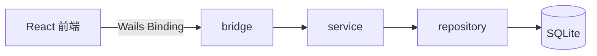

# 文档编写规范

> 状态：已生效 | 最后更新：2026-10-15

---

## 1. 写作前先问三个问题

1. **读者是谁？** 决定详略。给运维看要命令，给新人看要背景。
2. **这是唯一来源吗？** 同义内容已有 -> 改写链接，不复制。
3. **三个月后还能信吗？** 会过期的内容（版本号、截图、接口字段）必须标注核对日期。

## 2. 文件头模板

每个文档第一行起：

```markdown
# 标题

> 状态：草稿 | 评审中 | 已生效 | 已废弃
> 负责人：@名字
> 最后更新：YYYY-MM-DD
> 相关：[链接](...) · [链接](...)

一句话说明本文解决什么问题。
```

- **状态**：`草稿` 可在任何目录出现；`已废弃` 必须写替代文档链接，且不再维护正文。
- **负责人**：单人，避免"大家的文档"。

## 3. 结构与排版

- 一级标题只有一个，与文件名语义一致。
- 章节编号 `## 1.` → `### 1.1`，最多三层；超过三层说明该拆文件。
- 一个段落只讲一件事，超过 6 行拆成列表。
- 列表项统一用 `-`；有序步骤才用 `1.`。
- 术语首次出现给出中英对照：`单向同步（one-way sync）`。
- **不要**用"简单""好用""很快"这类不可验证的词；给数字或对比。

## 4. 代码与配置

- 代码块必须标语言：```go / ```ts / ```tsx / ```bash / ```sql / ```json。
- 命令必须可直接复制执行，含完整路径或明确工作目录。
- 示例数据用占位符，不用真实数据：

| 占位符 | 含义 |
| --- | --- |
| `TARGET_HOST` | 邮件服务器地址 |
| `ACCOUNT_ID` | 账号标识 |
| `TOKEN` | 凭据 |
| `MAILBOX` | 邮箱文件夹名 |

## 5. 链接规则

- 站内链接一律**相对路径**（`../02-architecture/overview.md`），不要绝对路径，不要 `file://`。
- 文件名全小写中划线；中文标题可以，文件名不行。
- 引用外部资料必须写访问日期，防止链接失效后无从考证。

## 6. 图表

- 优先 Mermaid（可 diff、可在 GitHub 渲染），其次 ASCII 图，最后才用图片。
- 图片放同级 `assets/`，命名 `功能-内容.png`，并提供替代文本。
- 截图必须标注版本，写法示例（放在代码块中展示，避免产生失效链接）：

```markdown

```



## 7. 各类型文档骨架

### 功能设计（`01-product/features/FEAT-xxxx.md`）
背景 / 用户故事 / 交互流程 / 数据与接口影响 / 验收标准 / 非目标 / 度量。

### 架构决策（`02-architecture/adr/ADR-xxxx.md`）
状态 / 背景 / 备选方案（≥2） / 决策 / 后果（正面+负面） / 何时需要重新评估。

### 测试用例（`05-testing/test-cases/TC-xxx.md`）
前置条件 / 步骤 / 预期 / 实际 / 结果。

### 缺陷（`05-testing/bug-reports/BUG-YYYYMMDD-NN.md`）
环境 / 复现步骤 / 期望 vs 实际 / 日志 / 影响范围 / 优先级。

## 8. 维护

- 代码 PR 改了行为 -> 同 PR 改文档，reviewer 检查此项。
- 每季度扫描：`grep -r "最后更新" docs` 找出超过 90 天的 `已生效` 文档，逐条确认。
- 内容失效时：优先**修正**，其次**标注废弃 + 指向替代**，不要悄悄删除历史决策。

## 9. 禁止项

- 禁止把密钥、内网地址、真实用户信息写进文档。
- 禁止"待补充""同上""参见代码"作为正文唯一内容（至少要给出定位：文件+函数）。
- 禁止在文档里粘贴大段生成物（生成的 JSON、完整堆栈），只留关键片段 + 链接日志文件。
