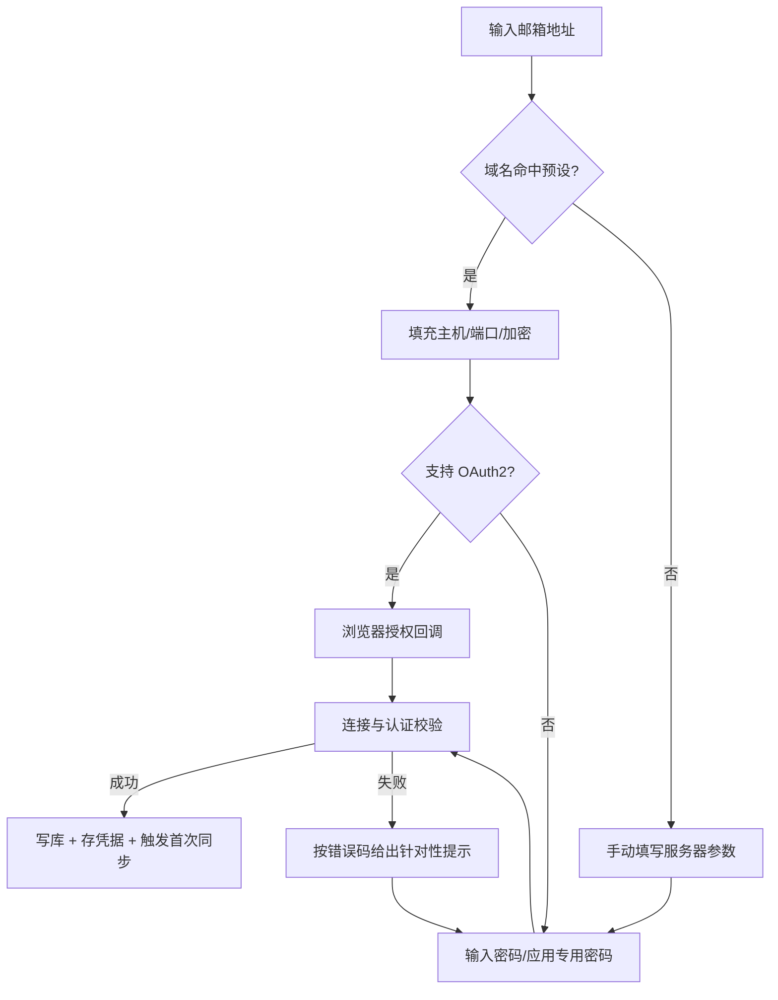

# FEAT-0001 账号接入向导

> 实现核对（2026-10-29）：已提供密码/应用授权码弹窗，真实 TLS IMAP/SMTP 双认证后保存
> 系统凭据与账号，失败有补偿；仅本地 TLS 服务与 Windows 原生凭据经过验证。
> 当前界面为“选择服务商 → 配置账号 → 验证连接 → 同步邮件”四阶段，复用 AddAccount 内的
> 认证、保存及后台首次同步安排，不新增下文示例 Probe 接口，也不宣称历史邮件已全部同步。
> 预设账号隐藏协议/服务器配置，复用 Providers 端点和一套邮箱凭据；Gmail 使用应用专用密码，
> 自定义 IMAP/SMTP 仍保留完整配置与独立发信凭据；未新增 OAuth 登录能力。
> 已支持同一服务商单批最多 10 个账号，逐账号独立凭据、串行验证保存、部分失败只重试未添加项；
> 保存/通信结果不确定时需先核对，不直接重试。不是混合服务商导入，也不是跨账号原子事务。
> 预设账号从首项开始使用同一编辑卡片，新增后其余项折为摘要；切回旧项时在原位置展开，
> 顺序不变，未填写项也可编辑。界面复用不改变单账号请求或自定义端点/凭据行为。
> 下文 OAuth 浏览器授权、DPAPI 降级等仍不是已实现能力，不能照此宣称全量验收。

> 状态：开发中 | 负责人：@backend-lead | 最后更新：2026-10-29
> 需求：[FR-01-1/2/3/6](../requirements.md) | 相关：[FEAT-0004 同步引擎](FEAT-0004-sync-engine.md)

---

## 1. 背景与目标

用户添加邮箱必须**一次成功**。目标是：输入邮箱地址后，80% 的常见服务商无需手填服务器参数；
手动配置在失败时给出可自愈的提示，而不是"连接失败"。

## 2. 用户故事

- 作为用户，输入 `name@gmail.com` 后点"下一步"就能完成授权，不需要知道 IMAP 端口。
- 作为用户，配置失败时我能看到"是密码错还是网络不通还是服务商禁用了 IMAP"。
- 作为用户，我的密码不会以明文形式存在于任何文件中。

## 3. 交互流程



### 错误码映射

| 错误码 | 判定 | 用户提示 |
| --- | --- | --- |
| `AUTH_INVALID` | `NO [AUTHENTICATIONFAILED]` | 账号或密码不正确；Gmail/Outlook 需使用应用专用密码 |
| `AUTH_REQUIRED_OAUTH` | 服务器声明 `AUTH=XOAUTH2` 且禁用密码 | 该服务商要求授权登录，请使用"授权登录"按钮 |
| `NET_TIMEOUT` | 连接超时（10s） | 无法连接 `TARGET_HOST:993`，请检查网络或端口 |
| `TLS_INVALID` | 证书链校验失败 | 服务器证书无效，请确认是否为公司自建服务器 |
| `IMAP_DISABLED` | 认证成功但无 `IMAP4rev1` | 账号已连接，但服务商侧 IMAP 未开启（附开启指引链接） |
| `RATE_LIMITED` | 服务端返回过多连接 | 请求过于频繁，请稍后重试 |

## 4. 数据结构与接口影响

```go
// domain/account.go
type Account struct {
    ID           string    `json:"id"`            // UUID
    DisplayName  string    `json:"displayName"`
    Email        string    `json:"email"`
    Provider     string    `json:"provider"`      // gmail / outlook / qq / custom
    IMAP         ServerCfg `json:"imap"`
    SMTP         ServerCfg `json:"smtp"`
    AuthKind     string    `json:"authKind"`      // password | oauth2
    Enabled      bool      `json:"enabled"`
    CreatedAt    time.Time `json:"createdAt"`
    LastSyncAt   *time.Time `json:"lastSyncAt"`
}

type ServerCfg struct {
    Host     string `json:"host"`
    Port     int    `json:"port"`
    Security string `json:"security"` // ssl | starttls | none
}
```

- 凭据存系统钥匙串，键：`omnimail/account/<ACCOUNT_ID>`，值为序列化凭据对象。
- 数据库只存 `credential_ref`（钥匙串条目名），**不存密文**。

绑定方法：

```ts
// frontend/src/lib/bridge/types.ts
interface AccountAPI {
  probe(input: ProbeInput): Promise<ProbeResult>;      // 只校验，不落库
  create(input: CreateAccountInput): Promise<Account>; // 校验 + 落库 + 存凭据
  list(): Promise<Account[]>;
  remove(id: string, purgeLocal: boolean): Promise<void>;
}
```

## 5. 后端设计要点

- `service/account_service.go`：`Probe` 与 `Create` 复用同一 `dialer`，避免"校验通过但保存后连不上"。
- `probe` 顺序：TCP 连接 → TLS 握手 → `CAPABILITY` → `LOGIN/XLIST` → `SELECT INBOX`，任一步失败返回对应错误码，**不重试**（避免触发限流）。
- 密钥不落日志：`logger` 对字段名含 `password|token|secret` 的值自动打码。
- 预设表放 `config/providers.go`，新增服务商不改逻辑。

## 6. 前端设计要点

- 单页三步：`邮箱 → 授权/密码 → 校验结果`，支持后返回修改。
- 校验中禁用"完成"按钮并展示分阶段进度（连接 / 认证 / 读取文件夹）。
- 错误展示区：错误码对应的标题 + 可展开的 `detail`（仅在开发模式或"显示详情"时展开）。
- 密码框不提供"显示密码"以外的持久化选项；不写入 localStorage。

## 7. 验收标准

- [ ] 输入 Gmail 地址，自动填充 `imap.gmail.com:993 SSL` / `smtp.gmail.com:465 SSL`。
- [ ] 错误密码 3 次内均返回 `AUTH_INVALID`，且账号未落库。
- [ ] 超时场景 10s 内返回 `NET_TIMEOUT`，UI 不冻结。
- [ ] 成功添加后 5s 内触发首次同步并有进度反馈。
- [ ] 全程抓日志，确认无密码/令牌明文出现。
- [ ] 移除账号选择"删除本地数据"后，DB 中该账号相关行数为 0，钥匙串条目被删除。

## 8. 非目标

- 不自动探测未知服务商端口（用户必须确认参数）。
- 不支持 Exchange ActiveSync / EWS（v2 评估）。

## 9. 度量与观测

`account_probe_total{result,code}`、`account_probe_duration_ms`、`account_create_total{provider}`。
成功率低于 85% 触发预设表排查。

## 10. 风险与开放问题

- 部分企业服务器要求 `ID` 命令标识客户端，可能被拒；待验证是否需要配置项。
- OAuth2 在无系统浏览器的环境下如何回退（改用设备码？）——待 [ADR 待定](../../02-architecture/adr/README.md)。
