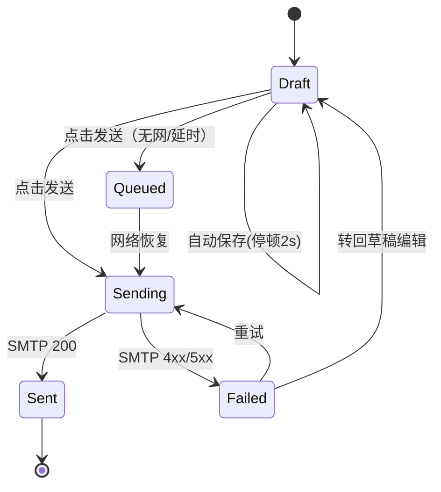

# FEAT-0003 撰写与发送

> 状态：草稿 | 负责人：@backend-lead | 最后更新：2026-10-15
> 需求：[FR-02-4~8](../requirements.md) | 相关：[FEAT-0004](FEAT-0004-sync-engine.md)

---

## 1. 背景与目标

写信必须"永不丢内容"。默认纯文本，避免把 Office 样式带入邮件；草稿本地优先保存，
发送失败可重试且状态可见。

## 2. 用户故事

- 我在写一半时关掉应用，下次打开内容还在。
- 我断网时点发送，邮件进入发件队列，联网后自动发出。
- 我修正一封已发草稿，历史版本可回退（至少最近 5 个版本）。

## 3. 交互流程



- 关闭窗口/切换草稿时若未保存，先同步落盘（同步写，≤ 20ms）。
- 发送前校验：至少一个收件人、主题为空时二次确认（可设"不再提示"）。

## 4. 数据结构与接口影响

```go
type Draft struct {
    ID         string    `json:"id"`
    AccountID  string    `json:"accountId"`
    InReplyTo  string    `json:"inReplyTo,omitempty"`
    References []string  `json:"references,omitempty"`
    To         []Contact `json:"to"`
    Cc         []Contact `json:"cc"`
    Bcc        []Contact `json:"bcc"`
    Subject    string    `json:"subject"`
    BodyText   string    `json:"bodyText"`   // 纯文本，唯一可信来源
    BodyHTML   string    `json:"bodyHTML"`   // 可选富文本，发送时降级
    Attachments []AttachmentRef `json:"attachments"`
    UpdatedAt  time.Time `json:"updatedAt"`
    Version    int       `json:"version"`    // 乐观锁
}
```

```ts
interface ComposeAPI {
  save(draft: Draft): Promise<{ id: string; version: number }>; // version 不匹配 -> CONFLICT
  send(id: string): Promise<{ queued: boolean; messageId?: string }>;
  listDrafts(accountId?: string): Promise<Draft[]>;
  discard(id: string): Promise<void>;
}
```

版本冲突策略：`CONFLICT` 时前端提示"该草稿已在别处修改"，提供"覆盖/重新加载"。

## 5. 后端设计要点

- 自动保存：前端 debounce 2s 调 `save`，后端按 `version` 做乐观锁；每 60s 强制一次。
- 附件：先写入 `cache/attachments/<sha256>`，Draft 引用哈希；发送时流式读取，不整块进内存。
- SMTP 发送使用 `net/smtp` 或 `go-smtp`，超时 60s；失败分类：`SMTP_AUTH`（凭据失效，暂停重试）、`SMTP_TEMP`（4xx，指数退避重试 3 次）、`SMTP_PERM`（5xx，转回草稿）。
- `Message-ID` 由本地生成并入库，保证幂等：重试时若服务器已收下，不重复发送（同一 Message-ID + 已存在 Sent 记录则视为成功）。
- 编码：主题用 RFC 2047，正文 UTF-8 + quoted-printable/base64，附件 base64 分块。

## 6. 前端设计要点

- 编辑器：默认纯文本（等宽字体可选），富文本模式通过工具栏切换，切换时**双向转换并提示可能丢失格式**。
- 保存状态指示：`保存中… / 已保存 HH:mm / 保存失败（重试）`。
- 快捷键：`Ctrl/Cmd+Enter` 发送，`Ctrl/Cmd+S` 立即保存，`Esc` 关闭并保存。
- 收件人输入：分隔符 `, ; 空格` 均可，输入 3 字符后给出历史联系人补全（仅本地）。
- 发送后从草稿列表移除，进入"发件箱"占位条目直至服务器确认。

## 7. 验收标准

- [ ] 连续输入 30s，期间仅触发 1 次自动保存（停顿触发）。
- [ ] 强制结束进程后重启，草稿内容与关闭前一致（含光标前后 20 字符内容）。
- [ ] 断网发送 -> 进入队列，UI 显示"等待网络"；恢复网络后 30s 内发出。
- [ ] 错误 SMTP 凭据 -> 提示重新授权，不进入无休止重试。
- [ ] 25MB 附件上传时内存增长 < 60MB。
- [ ] 附件超限时明确提示上限与替代方案（链接/Ctrl 建议）。

## 8. 非目标

- v1 不做邮件模板与签名管理（签名仅单行文本）。
- v1 不做 PGP 签名/加密。
- 不做协同编辑。

## 9. 度量与观测

`draft_save_total{result}`、`send_total{result,class}`、草稿丢失事件（应为 0）、发送 P95 耗时。

## 10. 风险与开放问题

- 富文本 -> 纯文本转换的规则需固定（列表、引用、换行），否则每次切换内容漂移。见 [ADR 待定](../../02-architecture/adr/README.md)。
- 部分服务商对 `Bcc` 处理不同（写入 Sent 时是否保留），需实测。
