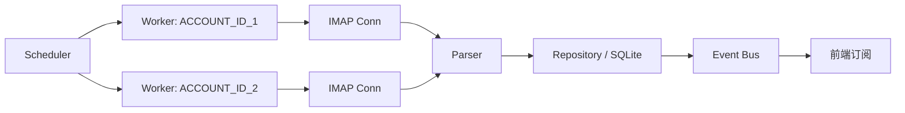
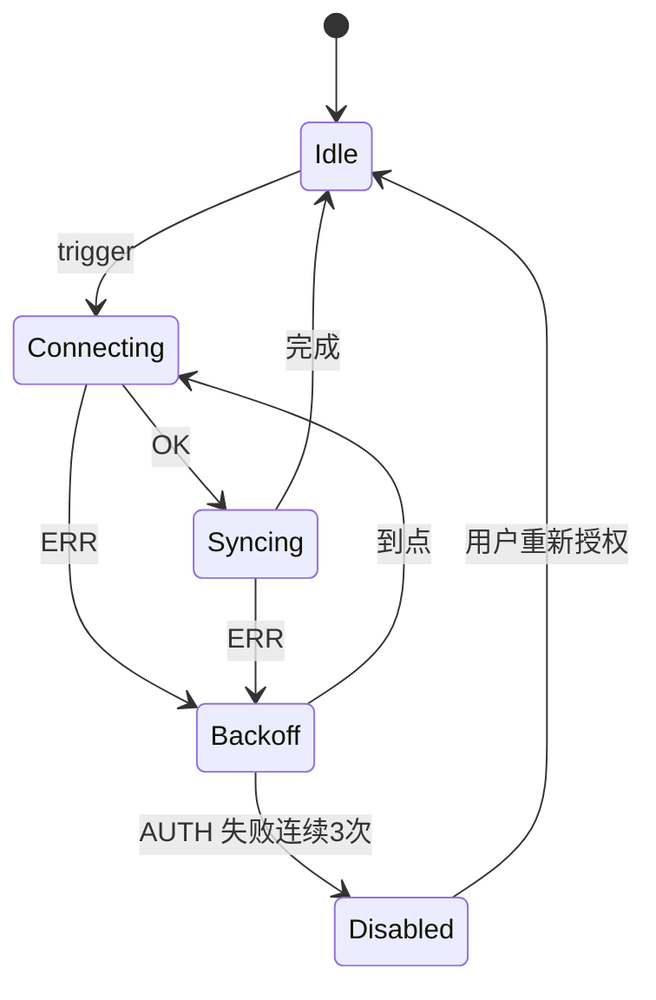

# FEAT-0004 同步引擎

> 状态：草稿 | 负责人：@backend-lead | 最后更新：2026-10-15
> 需求：[FR-03-*](../requirements.md) | 相关：[FEAT-0001](FEAT-0001-account-onboarding.md) · [ADR 同步策略](../../02-architecture/adr/README.md)

---

## 1. 背景与目标

同步是桌面邮件客户端最容易出问题的地方。目标：**可观测、可恢复、可限流**——
任何一次失败都能告诉用户"哪一步、为什么、下一步做什么"，且不产生数据错乱或重复。

## 2. 用户故事

- 我能随时看到每个账号最近一次同步的时间与结果。
- 断网后恢复，应用自己追上进度，不需要我点"刷新"。
- 我在离线时删除邮件，联网后服务器状态与本地一致，不会"复活"。

## 3. 总体结构



- 每个账号一个 Worker，内置状态机：`idle → connecting → syncing → idle | backoff`。
- Scheduler 负责触发：首次、定时轮询、IDLE 通知、用户手动、网络恢复事件。
- 全局并发上限 3 个连接（会计入连接数，避免被服务商限流）。

## 4. 账号状态机



退避：`1s, 2s, 5s, 15s, 60s, 300s`（上限 5 分钟，带 ±20% 抖动）。
`AUTH_INVALID` / `AUTH_REQUIRED_OAUTH` 不重试，直接进 `Disabled` 并通知用户。

## 5. 增量同步协议细节

```go
type MailboxState struct {
    AccountID   string    `json:"accountId"`
    Mailbox     string    `json:"mailbox"`      // INBOX / "[Gmail]/Sent Mail" ...
    UIDValidity uint32    `json:"uidValidity"`  // 变化即需全量重建
    UIDNext     uint32    `json:"uidNext"`
    HighestModSeq uint64  `json:"highestModSeq"`// 支持 CONDSTORE 时使用
    LastSyncAt  time.Time `json:"lastSyncAt"`
}
```

流程（单文件夹）：

1. `SELECT MAILBOX` -> 读 `UIDVALIDITY`。
2. 若 `UIDVALIDITY` 变化 -> 标记该文件夹本地数据为过期，执行重建（保留用户标记，如星标）。
3. 支持 `CONDSTORE/QRESYNC` 时：用 `HIGHESTMODSEQ` 做增量标志位同步。
4. 否则：`UID FETCH UIDNEXT:*` 拉新 + `UID SEARCH UID <lastHighest:*>` 检测变更。
5. 判定删除：本次 `SEARCH ALL` 结果集中缺失的 UID 标记为待删（两次确认后删除，防抖动）。
6. 每批 ≤ 200 封，批间释放连接资源并检查 `ctx.Err()`。

## 6. 本地操作队列（离线优先）

```sql
CREATE TABLE pending_ops (
  id         INTEGER PRIMARY KEY,
  account_id TEXT NOT NULL,
  kind       TEXT NOT NULL,       -- mark_read|set_star|move|delete|append_draft|send
  payload    JSON NOT NULL,
  attempts   INTEGER NOT NULL DEFAULT 0,
  last_error TEXT,
  not_before INTEGER NOT NULL,    -- 退避时间戳(epoch ms)
  created_at INTEGER NOT NULL
);
```

处理规则：

- 按 `created_at` 顺序、同账号串行执行。
- 同一目标的幂等合并（例如同一封邮件多次 mark_read 只保留最后状态）。
- `attempts >= 8` 或 `SMTP_PERM` 类错误 -> 移入 `failed_ops` 并在 UI 提示。

## 7. 数据结构与接口影响

```ts
interface SyncAPI {
  status(): Promise<AccountSyncState[]>;      // 每账号状态
  sync(accountId?: string): Promise<void>;    // 手动触发
  cancel(accountId: string): Promise<void>;
  onEvent(cb: (e: SyncEvent) => void): () => void;
}

type SyncEvent =
  | { type: 'state';  accountId: string; state: SyncState }
  | { type: 'progress'; accountId: string; mailbox: string; done: number; total: number }
  | { type: 'error';  accountId: string; code: string; message: string }
  | { type: 'new';    accountId: string; count: number };
```

## 8. 验收标准

- [ ] 3 账号同时同步，CPU 占用 < 30%（中端设备），UI 保持 60fps。
- [ ] `UIDVALIDITY` 变化时的重建不丢用户标记（星标/已读保留在 `mail_flags`）。
- [ ] 断网 30s 后恢复，10s 内自动重连继续同步。
- [ ] 服务器返回 `AUTH_INVALID` 连续 3 次后停止重试，UI 显示"需重新授权"。
- [ ] 离线删除 5 封、离线标星 3 封，联网后服务器状态一致，无重复、无复活。
- [ ] 强制退出应用再启动，不产生重复邮件行（按 `account_id+mailbox+uid` 唯一）。

## 9. 观测

| 指标 | 说明 |
| --- | --- |
| `sync_duration_ms{account}` | 单次同步耗时 |
| `sync_errors_total{code}` | 错误分类计数 |
| `pending_ops_backlog` | 待回写积压条数，> 500 告警 |
| `imap_conn_active` | 活跃连接数，应 ≤ 3 |

## 10. 风险与开放问题

- Gmail 的 `[Gmail]/All Mail` 与标签模型可能导致重复计数——需要按 mailbox 隔离去重。
- 超大附件/超长正文的 FETCH 可能超时，需 `BODY.PEEK[]` 分段拉取策略。
- `IDLE` 后重新 `SELECT` 的等待时间在网络差时明显，需实测调优。
