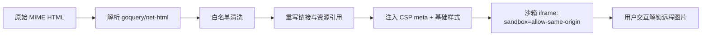

# FEAT-0007 邮件 HTML 安全渲染

> 状态：草稿 | 负责人：@security | 最后更新：2026-10-15
> 需求：[FR-02-9](../requirements.md) | 相关：[ADR-0005 渲染隔离](../../02-architecture/adr/ADR-0005-html-sandbox.md)

---

## 1. 背景与目标

邮件 HTML 是**不可信输入**：可含脚本、远程跟踪像素、钓鱼表单、超大内联资源。
目标是渲染得跟原始邮件接近，同时保证不执行代码、不泄露阅读行为。

## 2. 威胁模型

| 威胁 | 例子 | 对策 |
| --- | --- | --- |
| XSS | `<script>`、`onerror=`、`javascript:` | 服务端清洗 + iframe `sandbox` 无 `allow-scripts` |
| 跟踪像素 | 远程 1x1 图片 | 默认阻止远程资源，加载需用户点击 |
| 凭据钓鱼 | 仿冒登录表单 | 剥离 `<form>`，链接显示真实域名 |
| 导航劫持 | `target=_top` 外链 | 拦截点击，交由系统浏览器 `openExternal` |
| 资源放大 | 巨幅内联 base64 | 单邮件解码上限 10MB，超出截断并提示 |
| 探测与指纹 | CSS `@import`、`url()` | 禁止外部 CSS/字体，仅内联白名单属性 |

## 3. 渲染管线



### 白名单

- 允许标签：`html head body div p span a img table thead tbody tr td th ul ol li blockquote pre code h1-h6 hr br b i u strong em small font center`
- 允许属性：`href src alt title width height align valign colspan rowspan style class dir`
- `style` 仅保留：`color background-color font-size font-weight font-family text-align text-decoration padding margin width height border border-collapse vertical-align line-height white-space`
- 移除：`script iframe object embed form input button link meta base svg math video audio`（`video/audio` 移除，保留 Poster 提示）

### CSP（注入到 iframe 内）

```html
<meta http-equiv="Content-Security-Policy"
      content="default-src 'none'; img-src data: cid:; style-src 'unsafe-inline'; font-src 'none'; media-src 'none'; frame-src 'none';">
```

（用户点击"显示图片"后，动态追加 `img-src` 中的远程白名单主机。）

### 链接处理

- 所有 `a[href]` 重写为 `about:blank#omnimail-link`，真实 URL 放 `data-href`。
- 点击时前端校验：`http/https/mailto` 交给系统；其它协议（`javascript:` `file:` `data:`）静默丢弃并记录一次 `blocked_nav`。
- hover 时在状态栏显示真实域名（防 `paypal.com@evil.com` 类诱饵）。

## 4. 输入数据

```go
type RenderInput struct {
    MailID       string
    RawHTML      string            // 原始 HTML 部分（可能为空）
    RawText      string            // 纯文本回退
    InlineCIDs   map[string]string // cid -> 本地缓存文件路径
    AllowRemote  bool              // 用户已选择显示远程图片
    Theme        string            // light | dark：注入配色变量
}
```

## 5. 验收标准

- [ ] 含 `<script>alert(1)</script>` 的邮件不执行，控制台无报错。
- [ ] 含 `` 的邮件默认不发起该请求（抓包验证）。
- [ ] 点击"显示图片"后仅加载该邮件域下的图片，其它域仍被阻止。
- [ ] 含 `<form action="http://evil">` 的邮件不渲染输入框。
- [ ] 点击 `javascript:alert(1)` 链接无反应，日志记录 `blocked_nav`。
- [ ] 含 20MB base64 内联图的邮件渲染耗时 < 500ms 且内存峰值 < 80MB。
- [ ] 深色主题下，白底正文不刺眼（对比度 ≥ 4.5:1），且不是简单反色。

## 6. 非目标

- v1 不做完整 CSS 引擎模拟，复杂布局（flex/grid 邮件）允许降级。
- 不做 PGP 签名验证后的特殊渲染（另行评估）。
- 不做远程图片代理服务（保持本地处理）。

## 7. 风险与开放问题

- WebView2 与 WKWebView 对 `sandbox` 的支持差异需实测。
- 部分营销邮件依赖 `@media` 查询，移除后移动宽度下排版崩坏——是否降级为"原始邮件视图"按钮？
- 清洗库选择（`bluemonday` vs 自研白名单）需在 ADR-0005 定稿。
