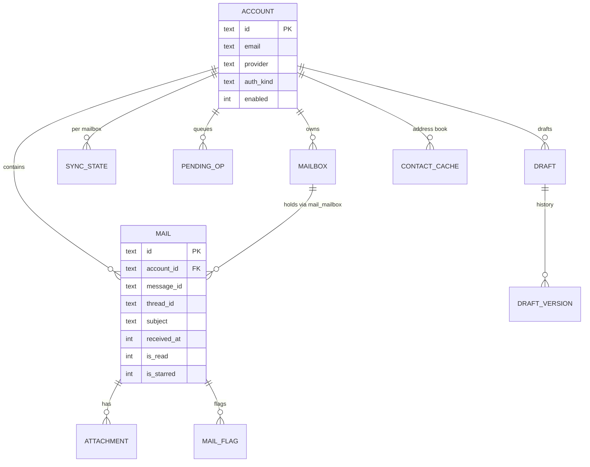

# 数据库设计

> 状态：账号及基础邮件缓存已提交，后续能力待实施 | 最后更新：2026-10-28
> 相关：[当前 Schema](schema-current.md) · [迁移与备份](migrations.md) · [ADR-0002](../adr/ADR-0002-local-storage.md)

## 当前实现（TASK-0030）

- 纯 Go SQLite 驱动、启动初始化与关闭、身份校验、版本及校验和迁移、升级前一致性备份。
- `account`、`account_endpoint`、`schema_migration` 三张表及账号内部仓储；输入校验、原子读写、
  断开保留配置、级联清除及未引用凭据识别。
- 服务商预设在领域层集中定义，新增预设无需迁移；真实连接配置随账号保存。
- TASK-0032～0036 已接入应用码账号 UI、系统凭据、TLS 认证、邮件缓存/轮询和纯文本发送；
  OAuth、IDLE、草稿/离线队列、缓存回收与性能指标仍是目标，真实服务商未实测。
- 实际结构及扩展步骤见 [当前 Schema](schema-current.md)，后续模型见 [实施设计](account-storage.md)。
- 下方历史草稿中的标识、去重、状态和查询示例仍需按实施设计修订，不能直接作为后续 DDL。

## 后续完整邮件模型草稿（不等同于当前缓存结构）

---

## 1. 选型与配置文件位置

| 项 | 结论 |
| --- | --- |
| 引擎 | 当前已使用 `modernc.org/sqlite v1.61.0`，见 [ADR-0007](../adr/ADR-0007-sqlite-driver.md) |
| 模式 | WAL，`synchronous=NORMAL`，`foreign_keys=ON` |
| 位置 | Windows `%APPDATA%\OmniMail\omnimail.db`；macOS `~/Library/Application Support/OmniMail/omnimail.db` |
| 附件 | 文件系统 `attachments/<sha256 前2位>/<sha256>`，DB 只存引用 |
| 索引 | FTS5 虚拟表（[ADR-0003](../adr/ADR-0003-sqlite-fts5.md)） |

## 2. 实体关系



## 3. 表清单

| 表 | 说明 | 预估行数（重用户） |
| --- | --- | --- |
| `account` | 账号配置（不含凭据） | < 10 |
| `mailbox` | 服务器文件夹映射 | < 100 |
| `mail` | 邮件头 + 摘要 + 纯文本正文 | 10 万 - 100 万 |
| `mail_mailbox` | 邮件与文件夹多对多（Gmail 标签模型） | 同 mail 的 1-2 倍 |
| `attachment` | 附件元数据（不含内容） | 10 万 |
| `thread` | 会话聚合 | mail 的 20%-40% |
| `mail_fts` | FTS5 全文索引 | 同 mail |
| `sync_state` | 每账号每文件夹的同步游标 | < 100 |
| `pending_op` | 离线操作队列 | 通常 < 100 |
| `failed_op` | 永久失败的操作（供用户处理） | < 100 |
| `draft` / `draft_version` | 草稿与历史版本 | < 200 |
| `contact_cache` | 收件人补全缓存 | < 5 万 |
| `settings` | 键值配置（非敏感） | < 100 |
| `schema_migration` | 迁移记录 | < 50 |

## 4. 关键设计原则

1. **本地 id 与服务器 id 分离**：`mail.id` 为 ULID；服务器标识用 `(account_id, mailbox_id, uid)` 唯一约束。
2. **时间统一存 Unix 毫秒整数**（`received_at`, `created_at`），避免时区与字符串排序问题。
3. **枚举存 TEXT**（可读、可迁移），不在代码外使用魔法数字。
4. **不存凭据**：`account.credential_ref` 只存钥匙串条目引用（[ADR-0004](../adr/ADR-0004-credential-storage.md)）。
5. **软删除优先**：邮件进 `trash` 用 `deleted_at` 标记，物理删除在清理任务中执行。
6. **所有写入走事务**：批量插入每批 ≤ 200 条，一个事务。

## 5. 索引策略

```sql
-- 列表主查询
CREATE INDEX idx_mail_account_received ON mail(account_id, received_at DESC, id);
CREATE INDEX idx_mail_thread          ON mail(thread_id, received_at);
CREATE INDEX idx_mail_flags           ON mail(account_id, is_read, is_starred);
CREATE UNIQUE INDEX ux_mailbox_uid    ON mail_mailbox(account_id, mailbox_id, uid);
-- 队列
CREATE INDEX idx_pending_due          ON pending_op(account_id, not_before, created_at);
```

原则：只为**已存在的查询**建索引；新查询先 `EXPLAIN QUERY PLAN` 验证是否走索引。

## 6. 容量与维护

| 项 | 策略 |
| --- | --- |
| 单库大小 | 目标 < 2GB；超过提示用户按账号/时间清理 |
| VACUUM | 每月一次（用户空闲 5 分钟后触发，可关） |
| 正文截断 | 单封正文入库上限 1MB，超出保存到 `bodies/<id>.html` 文件 |
| 附件清理 | 未被引用且超过 30 天的附件进入清理候选 |
| 一致性检查 | 启动时 `PRAGMA quick_check`（仅每周首次启动） |

## 7. 备份

- 每日一次自动备份：`backups/omnimail-YYYYMMDD.db`（`VACUUM INTO`），保留 7 份。
- 迁移前强制备份：`backups/pre-migration-v<目标版本>.db`。
- 恢复流程见 [migrations.md](migrations.md#4-恢复流程)。

## 8. 性能目标

| 场景 | 目标 |
| --- | --- |
| 列表首屏（1 万封） | ≤ 50ms |
| 分页（每页 50） | ≤ 15ms |
| 全文检索 | P95 ≤ 120ms |
| 批量写入 200 封 | ≤ 300ms |
| 首次导入 1 万封 | ≤ 60s（含索引） |
