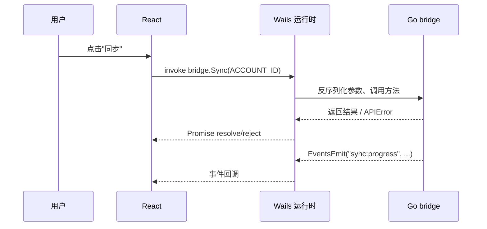

# Wails 桌面端架构

> 状态：草稿 | 负责人：@arch-lead | 最后更新：2026-10-15
> 相关：[平台能力](platform.md) · [总体架构](../overview.md) · [构建与发布](../../06-release/build.md)

---

## 1. 运行模型

Wails v2 架构：Go 进程内嵌系统 WebView（Windows = WebView2，macOS = WKWebView），
Go 侧通过生成的绑定暴露方法，前端通过 `window.go.*` 调用；Go 通过 `runtime.EventsEmit` 向前端推送。



## 2. 应用装配（`app` 包）

```go
func Run() error {
    cfg, err := config.Load()
    if err != nil { return err }

    log := logger.New(cfg)
    db, err := repository.OpenSQLite(ctx, cfg.DataDir)
    if err != nil { return err }

    svcSet := service.NewSet(db, cfg, log)
    binds  := bridge.NewSet(svcSet, log)

    application := &App{
        cfg:   cfg,
        log:   log,
        binds: binds,
        svc:   svcSet,
    }
    return wails.Run(&options.App{
        Title:            "OmniMail",
        Width:            1280,
        Height:           820,
        MinWidth:         960,
        MinHeight:        600,
        AssetServer:      &options.AssetServer{Assets: frontend.Assets},
        OnStartup:        application.startup,
        OnBeforeClose:    application.beforeClose,
        OnShutdown:       application.shutdown,
        SingleInstanceLock: &options.SingleInstanceLock{
            UniqueId: "com.omnimail.desktop",
            OnSecondInstanceLaunch: application.focusWindow,
        },
        Bind: []interface{}{binds.Account, binds.Mail, binds.Compose, binds.Sync, binds.Search, binds.Settings, binds.App},
    })
}
```

## 3. 窗口与 UI 状态

| 项 | 设计 |
| --- | --- |
| 尺寸 | 默认 1280×820，最小 960×600 |
| 位置 | 记住上次窗口位置与最大化状态（`window_state.json`） |
| 标题栏 | Windows 自定义标题栏（可拖拽区 `--wails-draggable`）；macOS 用系统标题栏 + 隐藏标题 |
| 关闭行为 | 默认最小化到托盘；`Shift+关闭` 直接退出 |
| 缩放 | WebView 缩放 90%-150%，快捷键 `Ctrl +/-` |
| 多显示器 | 恢复位置前校验是否在可见屏幕内，否则回落到居中 |

## 4. 前后端绑定清单

| 绑定方法 | 用途 | 是否长任务 |
| --- | --- | --- |
| `Account.Probe` | 校验账号参数 | 是（10s 超时） |
| `Account.Create` / `Remove` / `List` | 账号 CRUD | 否 |
| `Mail.Page` | 列表分页 | 否 |
| `Mail.GetBody` | 取正文 | 否（本地读） |
| `Mail.SetRead` / `SetStarred` / `Move` | 状态变更 | 否（入队） |
| `Compose.Save` / `Send` / `ListDrafts` | 撰写 | 否（发送入队） |
| `Sync.Status` / `Sync.Sync` / `Sync.Cancel` | 同步控制 | 是 |
| `Search.Query` | 搜索 | 否 |
| `Settings.Get` / `Update` / `ExportLogs` | 设置 | 否 |
| `App.Version` / `OpenDataDir` / `OpenExternal` | 应用信息 | 否 |

约定：所有方法返回 `(DTO, *APIError)`；参数与返回值均为 JSON 可序列化结构（无 channel、无函数）。

## 5. 前端资源

- 前端构建产物通过 `//go:embed all:frontend/dist` 嵌入二进制。
- 开发模式 `wails dev` 用 Vite 热更新，Go 侧改动自动重建。
- 生产构建：`wails build -platform windows/amd64 -tags production`。
- WebView2 缺失时提示安装（引导链接 + 静默安装失败后的降级提示）。

## 6. 生命周期与退出

```go
func (a *App) beforeClose(ctx context.Context) bool {
    if a.cfg.CloseToTray && !a.shiftPressed {
        runtime.WindowHide(ctx)
        return true // 阻止关闭
    }
    return a.flushAndConfirm(ctx) // false = 允许关闭
}

func (a *App) shutdown(ctx context.Context) {
    a.svc.Stop(ctx)          // 取消 context，等待 worker，上限 5s
    a.db.Checkpoint()        // WAL checkpoint
}
```

- 未保存草稿：退出前同步落盘；失败则弹窗阻止退出。
- 有进行中的发送任务：提示"正在发送 N 封，是否等待"。

## 7. 单实例与深链接

- `SingleInstanceLock` 保证唯一实例；二次启动把参数传给已有实例并聚焦。
- 深链接 `omnimail://open?account=ACCOUNT_ID&mail=MAIL_ID` 在 Windows 注册表 / macOS
  `Info.plist` 中注册，启动时解析并路由到指定邮件。

## 8. 更新策略

- v1：**手动更新**——应用内检查版本（读取静态版本清单 URL），提示下载安装包。
- v2 规划：自动更新（Windows 增量、macOS Sparkle 风格），需签名前置条件。
- 更新不迁移配置；跨 MAJOR 版本升级必须先读迁移说明。

## 9. 关键约束与坑位

| 项 | 约束 |
| --- | --- |
| 绑定方法 | 不能有 `context.Context` 参数（Wails 生成器会跳过），需要在内部派生 |
| goroutine | UI 操作（`runtime.*`）必须在主线程可安全调用的方法中执行 |
| 事件 | 高频事件必须节流（进度事件 ≥ 200ms 合并） |
| 嵌入资源 | 修改前端后必须重新 `wails build`，`go run` 不会热更新 |
| WebView2 | 依赖用户系统装载，需在构建产物中提供 bootstrapper |
| macOS | 需 `Info.plist` 权限声明（通知、辅助功能），否则快捷键静默失败 |
