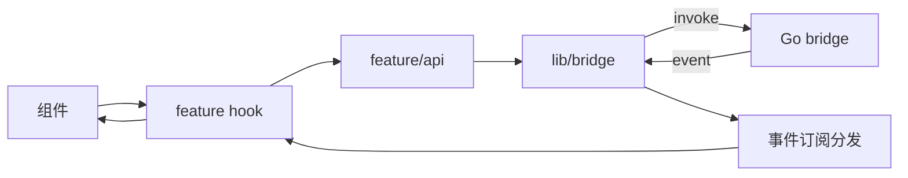

# React 前端架构

> 状态：草稿 | 负责人：@frontend-lead | 最后更新：2026-10-15
> 相关：[文件组织](file-organization.md) · [数据流](data-flow.md) · [总体架构](../overview.md)

---

## 1. 栈

| 项 | 选择 | 说明 |
| --- | --- | --- |
| 框架 | React 18 + TypeScript 5（strict） | Concurrent 特性可用，但避免滥用 `useTransition` |
| 构建 | Vite 5 | Wails 前端标准接入 |
| 路由 | React Router 6（HashRouter） | WebView 中 `file://` 与自定义协议更稳 |
| 状态 | Zustand（全局）+ 组件本地 state | 不引入 Redux，避免样板 |
| 数据获取 | 自定义 `useQuery` 封装（无外部库） | 请求经 Wails 绑定，非 HTTP |
| 样式 | CSS Modules + CSS 变量令牌 | 不引入 Tailwind（体积与团队偏好） |
| 表单 | 原生 + zod 校验 | 表单规模小 |

## 2. 目录结构

```
frontend/
├── index.html
├── vite.config.ts
├── tsconfig.json
├── package.json
├── wailsjs/                 # Wails 生成，勿手改
└── src/
    ├── main.tsx
    ├── app/
    │   ├── App.tsx
    │   ├── router.tsx
    │   ├── providers/       # Theme / Toast / ErrorBoundary / Keyboard
    │   └── layout/          # Shell / Sidebar / SplitPane
    ├── features/
    │   ├── accounts/
    │   ├── mail/
    │   ├── compose/
    │   ├── search/
    │   └── settings/
    ├── components/          # 通用：Button Input Dialog Tooltip VirtualList EmptyState ...
    ├── lib/
    │   ├── bridge/          # 绑定封装 + 类型 + 错误映射
    │   ├── format/          # 日期、文件大小、地址解析
    │   └── hooks/           # useDebounce useHotkeys useIntersection
    └── styles/
        ├── tokens.css
        └── globals.css
```

每个 `features/<x>` 结构固定：

```
<feature>/
├── components/     # 该功能的私有组件
├── hooks/          # 该功能的状态与副作用
├── api/            # 该功能对 bridge 的调用（薄）
├── store.ts        # 可选：Zustand slice
├── types.ts
└── index.ts        # 唯一对外出口
```

## 3. 数据流



- **所有 Go 调用只经 `lib/bridge`**：集中处理超时、错误映射、DTO 校验（zod）。
- **事件驱动更新**：`mail:new` / `sync:state` 等事件由 `lib/bridge/events.ts` 订阅一次，
  分发给各 store，组件订阅 store。
- 组件不直接 `invoke`，保证可替换（测试时替换 bridge 为 mock）。

## 4. 错误处理

```ts
// lib/bridge/errors.ts
export class BridgeError extends Error {
  constructor(public code: string, message: string, public detail?: string) {
    super(message);
  }
}

const FALLBACK = '操作失败，请稍后重试';

export function toUserMessage(e: unknown): string {
  if (e instanceof BridgeError) return MESSAGES[e.code] ?? FALLBACK;
  return FALLBACK;
}
```

- 页面级错误边界：捕获渲染错误，展示"该区域出错 + 重试"。
- 操作级错误：Toast（可带"重试"动作），连续失败合并显示。
- 致命错误（DB 打不开）：全屏错误态，含日志路径与"打开数据目录"按钮。

## 5. 性能策略

| 场景 | 手段 |
| --- | --- |
| 长列表 | 虚拟滚动（自研 `VirtualList`，固定行高 + overscan 6） |
| 大正文 | 详情分块渲染，首屏只渲染可视区域 |
| 搜索输入 | debounce 150ms + 请求可取消（丢弃过期结果） |
| 重渲染 | `React.memo` 仅用于列表行与纯展示组件；避免全局 store 导致全树更新 |
| 包体积 | 路由级 `React.lazy`；图标内联 SVG，不引整套图标库 |

## 6. 可访问性

- 所有交互元素可 Tab 到达，焦点可见（`:focus-visible` 2px 描边）。
- 列表支持 `role="listbox"` + `aria-activedescendant`。
- 图标按钮必须有 `aria-label`。
- 不只用颜色传达状态（未读同时有圆点与字重）。
- 动画尊重 `prefers-reduced-motion`。

## 7. 与 Wails 的约定

- 绑定方法名稳定，禁止在版本内改名（前端类型由生成文件提供）。
- 前端只依赖 `wailsjs/go/...` 中的导出方法；不 import Go 内部包概念。
- 窗口相关操作（最小化、全屏）经 `runtime.Window*`，统一封装在 `lib/bridge/window.ts`。

## 8. 测试

- 组件测试：Vitest + Testing Library，覆盖交互与四态（loading/empty/error/data）。
- bridge 用 mock 模块（`vi.mock`）注入固定返回值。
- E2E：见 [测试策略](../../05-testing/testing-strategy.md)，仅在发布前跑关键路径。
