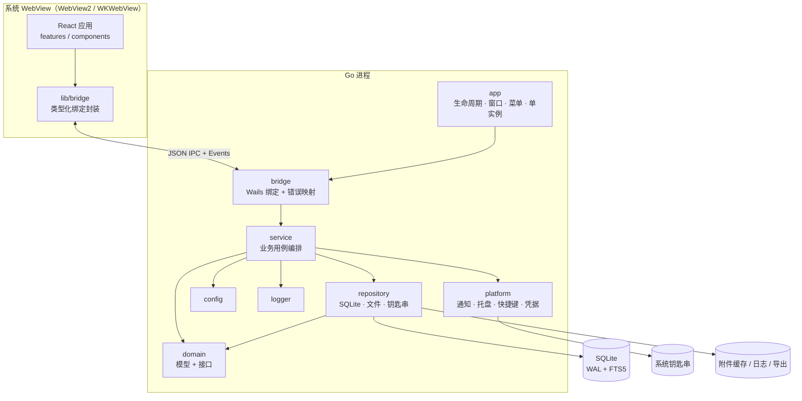

# 总体架构

> 状态：草稿 | 负责人：@arch-lead | 最后更新：2026-10-15
> 相关：[后端](backend/README.md) · [前端](frontend/README.md) · [桌面端](desktop/README.md) · [数据库](database/README.md) · [ADR](adr/README.md)

---

## 当前实现补充（2026-10-30，TASK-0050）

后台同步、正文读取与标记写入使用三个有界通道，每账号同类会话串行，互不共享 IMAP SELECT 状态。
后台全局额度为 3，正文额度为 3，标记额度为 2；每账号最多同时一个同步、一个正文和一个标记连接。
账号显式断开仍与所有活跃账号连接互斥，服务关闭取消请求并等待退出。

标记版本与同步落库通过短临界区协调：网络 FETCH 前记录版本，落库前核对，
用户在此期间得到服务器写入确认后使旧批次失效并重取；不持数据库/版本锁等待网络，
不永久覆盖服务器的后续真实变更。该策略不构成服务器与 SQLite 跨系统事务。
本轮行为由用户明确要求前台操作不被同步阻塞授权，替代先前任务中的同账号只读/写互斥降级；
其他历史架构目标仍不等同已实现。

## 1. 架构风格

**本地优先的单体桌面应用**：一个进程内的 Go 后端 + 一个系统 WebView 承载的 React 前端，
通过 Wails 绑定进行 IPC。没有自建服务端，所有状态在本机。

选择的理由见 [ADR-0001 技术栈选型](adr/ADR-0001-tech-stack.md)。

## 2. 分层视图



## 3. 关键设计决策

| 决策 | 结论 | 记录 |
| --- | --- | --- |
| 技术栈 | Wails v2 + Go 1.22+ + React 18 + TS | [ADR-0001](adr/ADR-0001-tech-stack.md) |
| 数据存储 | 单文件 SQLite（WAL）+ 文件系统存附件 | [ADR-0002](adr/ADR-0002-local-storage.md) |
| 搜索 | SQLite FTS5 + 应用层中文二元 | [ADR-0003](adr/ADR-0003-sqlite-fts5.md) |
| 凭据 | 系统钥匙串，DB 只存引用 | [ADR-0004](adr/ADR-0004-credential-storage.md) |
| HTML 渲染 | 服务端清洗 + 沙箱 iframe + CSP | [ADR-0005](adr/ADR-0005-html-sandbox.md) |

## 4. 运行时生命周期

```
启动
 ├─ 解析命令行与单实例锁
 ├─ 加载配置（%APPDATA%/OmniMail/config.json 或 ~/Library/Application Support/OmniMail/）
 ├─ 初始化 logger（文件轮转 + 控制台）
 ├─ 打开数据库 → 执行迁移 → 校验完整性
 ├─ 注册 bridge 绑定、通知/托盘/快捷键
 ├─ 创建窗口 → 前端挂载 → 订阅事件
 └─ 启动同步调度器（延迟 500ms，避免抢占首屏资源）

退出
 ├─ 停止调度器（取消 context，等待 worker 退出，超时 5s）
 ├─ 冲刷待保存草稿与 pending_ops
 ├─ 关闭数据库（WAL checkpoint）
 └─ 释放托盘、快捷键、单实例锁
```

## 5. 进程与并发模型

- 单进程。Wails 主线程负责 UI 事件循环；Go 侧业务跑在独立 goroutine。
- bridge 方法默认在 Go 的 goroutine 中执行，阻塞调用不得触碰 UI 线程对象。
- 长任务（同步、索引重建、大附件）必须接收 `context.Context` 并支持取消。
- 事件推送（Go → 前端）通过 `runtime.EventsEmit`；前端在组件卸载时取消订阅，避免泄漏。

## 6. 错误与日志边界

| 层 | 职责 |
| --- | --- |
| repository | 包装底层驱动错误，返回领域错误（`ErrNotFound` 等） |
| service | 决定重试/降级，补充上下文，产出 `AppError{Code, Message, Detail}` |
| bridge | 转换为 JSON 结构返回，不抛 panic |
| 前端 | 按 `code` 映射文案与恢复动作，未知 `code` 走兜底提示 |

## 7. 安全边界

1. 凭据只在 `platform/credential` 与内存中短暂存在，不落 DB、不落日志。
2. 邮件 HTML 视为不可信（[FEAT-0007](../01-product/features/FEAT-0007-safe-html-render.md)）。
3. 前端无文件系统直接访问权，全部经绑定方法与路径白名单。
4. 对外链接统一 `openExternal`，协议白名单 `http/https/mailto`。
5. 无遥测上传；任何统计默认本地，开关关闭即不采集。

## 8. 跨端关系

```
desktop/  Wails（Go + React）       ← 本目录文档
android/  独立实现                   ← 共享 07-protocol 约定（仓库根 docs）
ios/      独立实现
```

跨端只共享**协议与字段命名**（仓库根 `docs/`），不共享代码。
